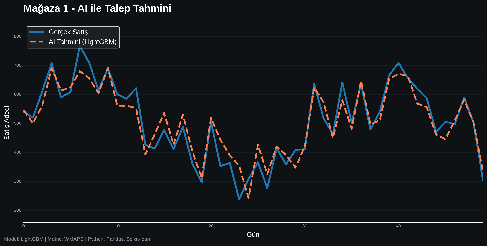
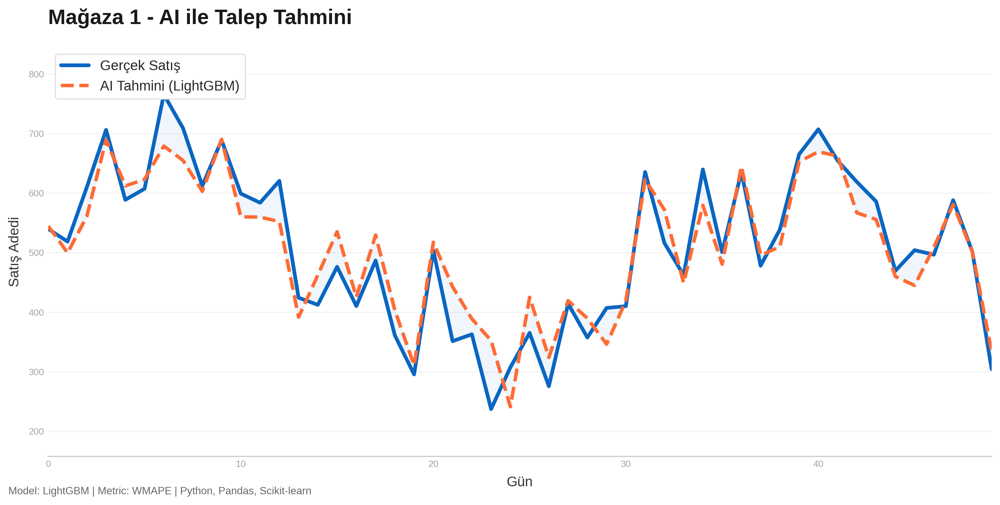

# AI-Powered Demand Forecasting - Tedarik Zinciri

Perakende satış verisi için Python & LightGBM ile geliştirdiğim ilk AI projem.

## 🚀 Ne Yaptım?
- Mağaza bazlı günlük satış tahmini
- Feature Engineering: lag_7, rolling mean, hafta günü
- Model: LightGBM Regressor
- Metric: WMAPE

## 📊 Sonuç

## 🛠️ Tech Stack
Python, Pandas, LightGBM, Matplotlib

## 👤 
Vedat Cengelci | Endüstri Mühendisliği 3. Sınıf | Supply Chain & Data Science

#SupplyChain #MachineLearning #DemandForecasting
